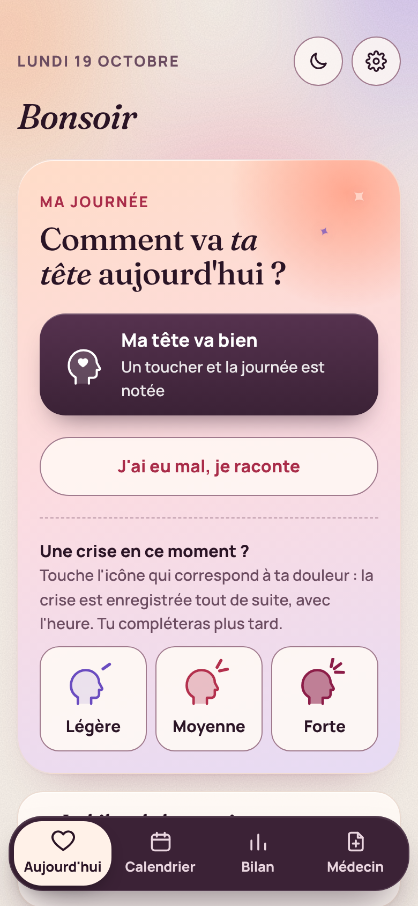
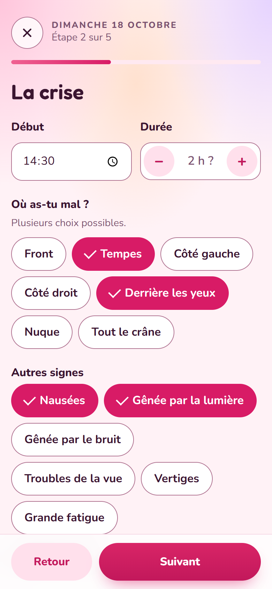
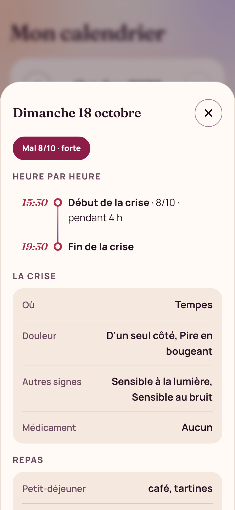
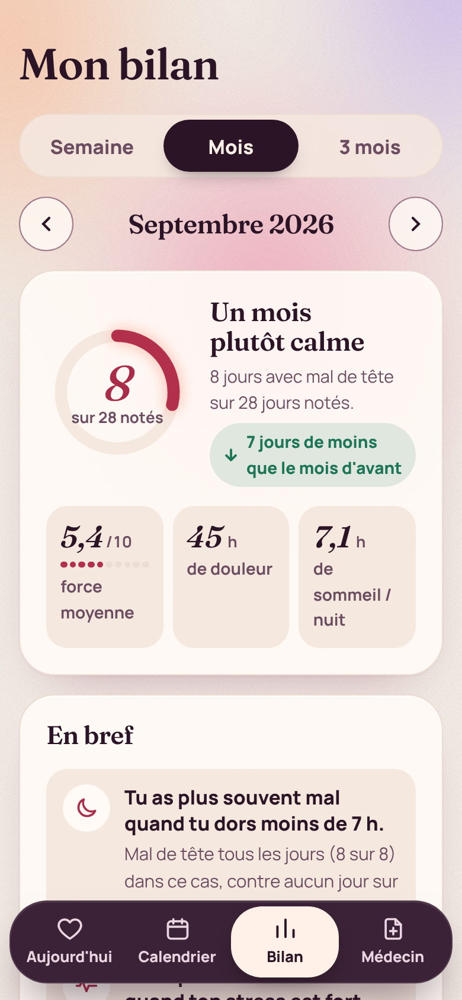
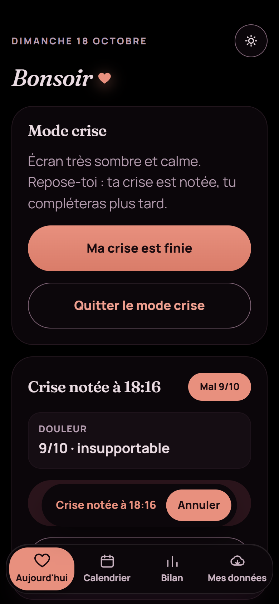
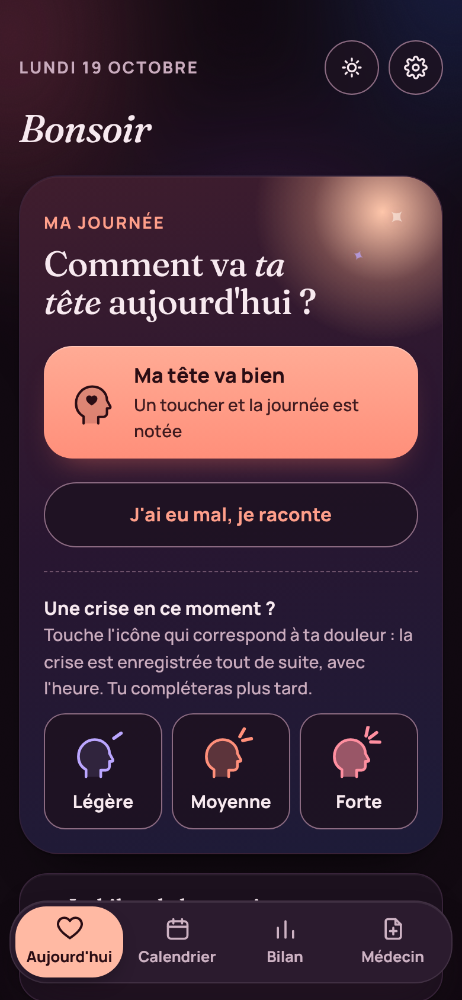

<div align="center">


# Mon Journal Migraines

**Un journal des maux de tête pour Android, 100 % local.**
Noter sa journée en quelques touchers, voir le bilan de la semaine et du mois, et préparer un rapport PDF pour le médecin.


</div>

---

## Sommaire

- [Captures d'écran](#captures-décran)
- [Pourquoi cette appli](#pourquoi-cette-appli)
- [Fonctionnalités](#fonctionnalités)
- [Vie privée et données](#vie-privée-et-données)
- [Installer sur le téléphone](#installer-sur-le-téléphone)
- [Stack technique](#stack-technique)
- [Fabriquer l'APK](#fabriquer-lapk)
- [Tests](#tests)
- [Organisation du projet](#organisation-du-projet)
- [Publier une nouvelle version](#publier-une-nouvelle-version)
- [Historique des versions](#historique-des-versions)
- [Contribuer](#contribuer)
- [Licence](#licence)
- [Avertissement médical](#avertissement-médical)

## Captures d'écran

<p align="center">
  
  
  
</p>
<p align="center">
  
  
  
</p>

<sub>Captures réalisées avec des données d'exemple fictives.</sub>

## Pourquoi cette appli

Un médecin a besoin de savoir **à quelle fréquence** surviennent les maux de tête, **avec quelle force**, **quels médicaments** ont été pris et **ce qui les déclenche**. Ces informations s'oublient vite : l'appli permet de les noter chaque jour en moins d'une minute, et de les retrouver sous forme de bilans et d'un rapport prêt à imprimer.

Tout reste sur le téléphone : pas de compte, pas de serveur, pas d'abonnement.

## Fonctionnalités

### Noter sa journée
- **Accueil en une question** : « Comment va ta tête aujourd'hui ? », avec deux grandes tuiles (*J'ai eu mal* / *Pas de mal*). Une fois la journée notée, elle se retrouve dans *Ma semaine*, qui la rouvre d'un toucher.
- **Crise rapide** : un toucher sur *Légère*, *Moyenne* ou *Forte* (une tête qui se remplit comme une jauge) note la crise avec l'heure. On complète plus tard. Bouton **Annuler** et **Retirer cette crise** en cas d'erreur.
- **Mode crise** : un appui long sur *Forte* (ou *Passer en mode crise*) note la crise et passe l'appli en noir profond, sans animation, avec de gros boutons et l'essentiel seulement.
- **Fin de crise en un toucher** : *Ma crise est finie* calcule la durée. Une notification « Ta crise est-elle finie ? » arrive 2 h après une crise rapide, avec *Oui, c'est fini* ou *Pas encore* (nouveau rappel 1 h plus tard).
- **Comme d'habitude** : remplit les cases vides (repas, eau, café, sommeil, écrans, lunettes) d'après les 14 derniers jours.
- **Formulaire pas à pas** (4 à 5 écrans courts, avec barre de progression) :
  - la tête : mal ou pas, force de 1 à 10 sur un curseur ;
  - la crise : heure de début, durée, zones douloureuses, signes associés (nausées, lumière, bruit…), médicaments pris (autant que nécessaire, avec l'heure de prise et l'efficacité de chacun) ;
  - les repas : petit-déjeuner, midi, soir (avec l'heure si on veut), cafés ou thés, verres d'eau ;
  - la journée : port des lunettes, sommeil, temps d'écran, stress, cycle ;
  - pour finir : questions personnelles et notes libres.
- **Écart entre deux prises** : pour chaque médicament, l'écart minimum (notice ou médecin). L'accueil affiche « prochaine prise possible vers 21 h » et une notification prévient à l'heure.
- **Questions perso** : ajouter ses propres questions (*Sport aujourd'hui ?*), en Oui/Non ou réponse écrite. Les Oui/Non sont comparées dans le bilan.

### Voir et comprendre
- **Calendrier** coloré : chaque jour est une petite jauge qui se remplit selon la force de la douleur (léger 1/3, moyen 2/3, fort plein). Un toucher ouvre le détail complet du jour : la journée **heure par heure** (repas, début et fin de crise, chaque prise de médicament), puis toutes les autres infos par thème. À modifier ou supprimer.
- **Bilan de la semaine et du mois** :
  - anneau de synthèse et phrase (*« Une semaine plutôt calme »*) ;
  - **tendance** par rapport à la période d'avant ;
  - force moyenne, durée de douleur, sommeil moyen ;
  - graphique jour par jour ;
  - **En bref** : les pistes les plus nettes dites en phrases simples (« Tu as plus souvent mal quand tu dors moins de 7 h », « 3 jours sur 4 ») ;
  - **situation par situation** : jours avec mal selon le sommeil, les lunettes, le stress, l'eau, les écrans, le café, le cycle et les questions perso ;
  - aliments les plus fréquents les jours de mal, zones, signes, médicaments.
- **Questionnaire MIDAS** (gêne au quotidien sur 3 mois, utilisé par les neurologues) : proposé tous les 3 mois, score, grade et historique dans le bilan et le rapport.
- **Alerte médicaments** : bandeau si les prises dépassent les seuils de surveillance de l'abus médicamenteux (classification ICHD-3 : 10 jours par mois pour les triptans, 15 pour les antidouleurs simples).

### Pour le médecin et la sauvegarde
- **Rapport PDF** sur 1, 3, 6, 12 mois ou tout l'historique : résumé, mois par mois, jauge des médicaments vers les seuils d'alerte, délai de prise, moment des crises, facteurs observés, aliments à surveiller, historique MIDAS, détail de chaque crise.
- **Tableau** (CSV, s'ouvre dans Excel ou Google Sheets).
- **Sauvegarde** en un fichier, envoyé via le menu de partage Android (Drive, Gmail, WhatsApp…). **Restauration** depuis ce fichier ou un texte collé, sans jamais écraser un jour plus récent.
- **Rappel de sauvegarde** sur l'accueil si la dernière date de plus de 30 jours.

### Confort
- **Rappel du soir** (notification, 21 h par défaut, heure réglable) : seulement si la journée n'est pas encore notée.
- **Mode nuit** en un toucher, utile quand la lumière fait mal.
- **Bouton retour d'Android** géré : il recule dans l'appli au lieu de la fermer.
- **Tout effacer**, protégé par une confirmation à taper.

### Accessibilité
Contrastes vérifiés (au moins 4,5:1 pour le texte et 3:1 pour les contours des éléments interactifs), grandes zones à toucher, compatible avec le lecteur d'écran TalkBack, information jamais portée par la couleur seule, animations coupées si le téléphone le demande.

## Vie privée et données

| | |
|---|---|
| **Où sont les notes ?** | Dans le téléphone, dans l'espace privé de l'appli. Aucun serveur, aucun compte. |
| **Connexion internet** | Aucune : l'appli n'a pas la permission Internet, Android lui interdit toute connexion. |
| **Compte, publicité, statistiques** | Aucun. |
| **Permissions demandées** | Notifications (rappel du soir, fin de crise, prochaine prise), réveil et redémarrage du téléphone (pour que les rappels survivent à un redémarrage). |
| **Sauvegarde Google du téléphone** | Si elle est activée dans les réglages Android, Android peut inclure les notes de l'appli dans la sauvegarde Google du téléphone (chiffrée, liée au compte Google). Elles reviennent alors en réinstallant sur un nouveau téléphone. L'appli elle-même n'envoie rien. |
| **Si le téléphone casse** | Les sauvegardes envoyées ailleurs (Drive, mail) permettent de tout récupérer, même sans la sauvegarde Google. D'où le rappel mensuel. |

> ⚠️ Désinstaller l'appli ou faire « Effacer les données » dans les réglages Android supprime toutes les notes. Faire une sauvegarde avant.

## Installer sur le téléphone

1. Copier `Mon-Journal-Migraines.apk` sur le téléphone (câble USB, mail à soi-même, Drive…).
2. L'ouvrir depuis l'appli **Fichiers**, puis autoriser l'installation pour cette source si Android le demande.
3. **Mise à jour** : installer le nouvel APK par-dessus. Les notes sont conservées.

> **Changement de clé de signature (une seule fois)** : Android refuse d'installer un APK signé avec une autre clé par-dessus l'appli déjà installée. Dans l'ancienne appli : *Mes données* → *Faire une sauvegarde* (l'envoyer sur Drive ou par mail). Désinstaller, installer le nouvel APK, puis *Mes données* → *Remettre une sauvegarde (fichier)*. Les mises à jour suivantes, signées avec la même clé, s'installent de nouveau par-dessus.

L'APK n'est pas dans le dépôt : il se fabrique avec `npm run apk` (voir ci-dessous).

## Stack technique

| Couche | Choix | Rôle |
|---|---|---|
| Interface et logique | HTML, CSS, JavaScript, sans framework | Un seul fichier, `www/index.html` |
| Appli Android | [Capacitor](https://capacitorjs.com) 6.2 | Enveloppe la page dans une vraie appli Android |
| Plugins natifs | `@capacitor/app`, `filesystem`, `share`, `local-notifications` | Bouton retour, fichiers, menu de partage, rappel du soir |
| Stockage | `localStorage` de la WebView | Privé à l'appli, persistant |
| PDF | jsPDF 4.2.1 + jsPDF-AutoTable 5.0.8 | Rapport pour le médecin, intégré à l'APK |
| Polices | Fraunces (titres, chiffres) et Manrope (texte), via Fontsource | Intégrées à l'APK, aucune requête réseau |
| Icônes | `sharp` + `@capacitor/assets` | Icône adaptative et écrans de démarrage clair et sombre |
| Compilation | Node.js, Java 17, SDK Android 34, Gradle | Fabrication de l'APK |
| Tests | Node.js, sans dépendance | Logique de stockage, sauvegardes, partage, rappels |

**Android** : version minimale 5.1 (API 22), cible Android 14 (API 34).

## Fabriquer l'APK

### Clé de signature (une seule fois)

L'APK est une version de publication : signée, non débogable. La clé n'est jamais dans le dépôt. Elle se crée une fois :

```powershell
keytool -genkeypair -storetype PKCS12 -keystore "$env:USERPROFILE\.android\journal-migraines-release.jks" -alias journal -keyalg RSA -keysize 4096 -validity 10000 -dname "CN=Mon Journal Migraines"
```

Puis `android/keystore.properties` (ignoré par git) :

```properties
storeFile=C:/Users/<toi>/.android/journal-migraines-release.jks
storePassword=<mot de passe>
keyAlias=journal
keyPassword=<mot de passe>
```

> **Sauvegarder la clé `.jks` et son mot de passe hors du PC** (gestionnaire de mots de passe, clé USB). Sans eux, impossible de publier une mise à jour qui s'installe par-dessus : il faudrait désinstaller l'appli, donc repasser par une sauvegarde.

### Prérequis (une seule fois, sous Windows)

```powershell
winget install Microsoft.OpenJDK.17
```

Puis les outils Android en ligne de commande, installés dans `%LOCALAPPDATA%\Android\Sdk`, avec les paquets `platform-tools`, `platforms;android-34` et `build-tools;34.0.0`. Android Studio n'est pas nécessaire.

### Commandes

```powershell
$env:JAVA_HOME = "C:\Program Files\Microsoft\jdk-17.0.20.101-hotspot"
$env:ANDROID_HOME = "$env:LOCALAPPDATA\Android\Sdk"

npm install
npm test        # vérifie la logique
npm run apk     # fabrique Mon-Journal-Migraines.apk (publication, signé) à la racine
```

| Script | Ce qu'il fait |
|---|---|
| `npm run vendor` | Copie l'outil PDF et les polices dans `www/vendor` |
| `npm run sync` | `vendor`, puis copie l'appli dans le projet Android |
| `npm run apk` | `sync`, compilation Gradle, copie de l'APK à la racine |
| `npm test` | Lance les tests |

Pour redessiner l'icône : `node scripts/icons.js` puis `npx @capacitor/assets generate --android`.

## Tests

`npm test` exécute la logique de l'appli dans Node, avec un faux écran et un faux téléphone (fichiers, partage, notifications simulés) :

- une journée enregistrée est toujours là à la réouverture, un jour supprimé ne revient pas ;
- reprise unique des notes de l'ancienne version ;
- restauration sans écraser un jour plus récent, texte invalide refusé ;
- retrait d'une crise rapide (journée d'avant remise telle quelle) ;
- partage Android : texte en UTF-8, PDF intact, partage annulé non compté comme sauvegarde ;
- rappel du soir : 14 soirs programmés à la bonne heure, aucun rappel un soir déjà noté ;
- plusieurs médicaments par jour : ancien et nouveau format lus, chaque prise comptée dans le bilan, vieilles sauvegardes restaurées sans perte ;
- heures : fin de crise calculée (même après minuit), détail du jour rangé par heure et complet ;
- remise à zéro, seuils médicaments, bilan semaine et mois.

Les tests ne remplacent pas un essai sur un vrai téléphone (affichage, menu de partage, notifications).

## Organisation du projet

```
├── www/
│   └── index.html          l'appli (interface et logique)
├── android/                projet Android généré par Capacitor
├── assets/                 icône et écrans de démarrage sources
├── docs/captures/          captures d'écran du README
├── scripts/
│   ├── vendor.js           intègre l'outil PDF et les polices
│   ├── icons.js            dessine l'icône et l'écran de démarrage
│   ├── build-apk.js        compile l'APK avec Gradle
│   └── copy-apk.js         copie l'APK à la racine
├── tests/
│   └── app.test.js         tests de la logique
├── capacitor.config.json   identité de l'appli et réglages des plugins
└── package.json            dépendances et scripts
```

## Publier une nouvelle version

1. Augmenter `versionCode` (entier, +1) et `versionName` dans `android/app/build.gradle`, et `version` dans `package.json`. Sans cela, Android ne reconnaît pas la mise à jour.
2. `npm test` puis `npm run apk`.
3. Committer et étiqueter : `git tag -a v2.x -m "…"`.
4. **Toujours signer avec la même clé** (`journal-migraines-release.jks`, voir *Clé de signature*). Une autre clé obligerait à désinstaller l'appli, donc à repasser par une sauvegarde.

> Si vous distribuez votre propre version, changez l'identifiant `appId` dans `capacitor.config.json` (et `applicationId` dans `android/app/build.gradle`) pour qu'elle ne se confonde pas avec une autre installation.

## Historique des versions

| Version | Code | Contenu |
|---|---|---|
| **2.1** | 5 | Mode crise (appui long sur *Forte*), fin de crise en un toucher et notification, écart entre deux prises avec rappel, *Comme d'habitude*, questionnaire MIDAS, bilan plus fiable (seuils, aliments comparés, moment des crises, jauge médicaments, période 3 mois), rapport PDF aux couleurs de la v2, nouvelle icône et écran de démarrage, accessibilité (zoom 200 %, cibles de 44 px). |
| **2.0** | 4 | Refonte « Ciel intérieur » (aurore qui suit la journée, nouvelles polices, dock d'onglets, animations). Icônes météo pour la crise rapide. Bilan « En bref » en phrases simples. Accueil sans carte une fois la journée notée. Sécurité : données nettoyées à la restauration, CSP, jsPDF 4, APK de publication signé et non débogable. |
| **1.2** | 3 | Plusieurs médicaments dans une même journée, chacun avec son heure et son efficacité. Heure des repas. Détail du jour complet dans le calendrier, avec la journée heure par heure. Correction : les jours de douleur forte redeviennent visibles dans le calendrier. |
| **1.1** | 2 | Rappel du soir en notification, sans rappel si la journée est déjà notée. |
| **1.0** | 1 | Première version Android 100 % locale : journal, crise rapide, calendrier, bilans, rapport PDF, sauvegarde par le menu de partage, alerte médicaments, mode nuit. |

## Contribuer

Les suggestions et corrections sont les bienvenues : ouvrez une *issue* pour signaler un problème ou proposer une idée, ou une *pull request* avec vos modifications. Merci de lancer `npm test` avant d'envoyer un changement.

## Licence

Distribué sous licence [MIT](LICENSE) : libre d'utiliser, modifier et redistribuer, sans garantie.

## Avertissement médical

Cette appli est un **carnet personnel**. Les pistes du bilan sont des observations, pas un diagnostic, et ne remplacent pas l'avis d'un médecin.

Consulter en urgence (15 ou 112) en cas de mal de tête **brutal et inhabituellement violent**, de **faiblesse d'un côté du corps**, de **difficulté à parler** ou de **fièvre avec raideur de la nuque**.
